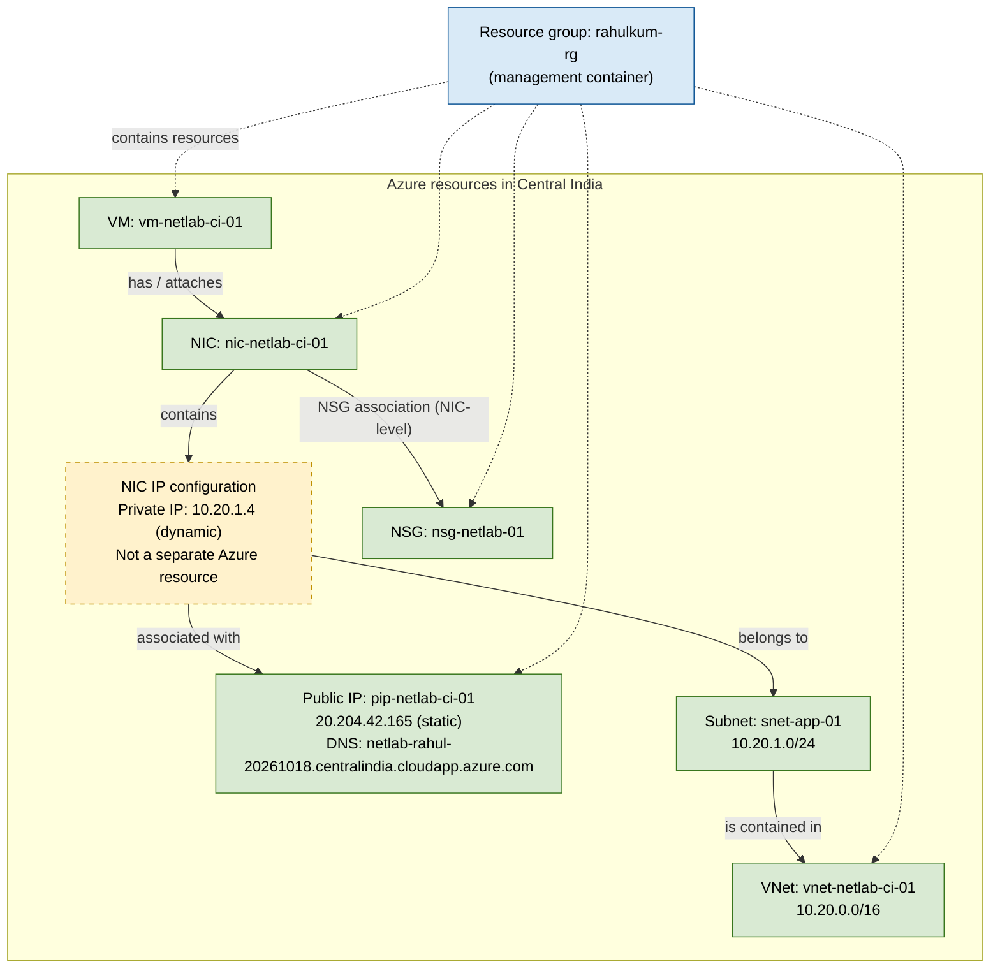

# Azure resource association diagram

This diagram reflects the current Azure setup, checked on October 18, 2026.

**Legend:** Green boxes are separately managed Azure resources. The yellow dashed box is a configuration object within a resource, not a separate Azure resource. The blue box is the resource group, which groups resources for management; it is not a network component or network hop.

## Is the original understanding correct?

Mostly yes. The VM has a NIC; the NIC connects the VM to the subnet in the VNet; the NIC is associated with a public IP and an NSG. The important precision is that Azure associates the **public IP with the NIC's IP configuration**, not directly with the NIC as an abstract object. That IP configuration also has the private IP and references the subnet. In everyday conversation, saying “the NIC has a public IP” is common shorthand.

For this deployment, the NSG is associated with the **NIC** (NIC-level). Azure also allows NSGs to be associated with subnets, but this subnet does not have an NSG association. A subnet is part of a VNet. These are associations and containment relationships; the NSG filters traffic but is not physically in-line as a separate appliance.

## Traffic path through these resources

For a public HTTPS request, the client connects to the DNS name, which resolves to the public IP. Azure maps that public-IP association to the NIC IP configuration. The NIC's NSG evaluates inbound TCP 443; if allowed, Azure delivers the traffic to the VM, where Docker publishes port 443 to Kestrel in the container.

The resource group is a management container for the Azure resources; it is not a network hop. Its metadata location (East US 2) is also distinct from the location of these network and compute resources (Central India).
